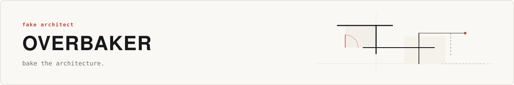

  <picture>
    <source media="(prefers-color-scheme: dark)" srcset="assets/plate-dark.svg" />
    
  </picture>

| Project | What | Footprint |
|---|---|---|
| [**hapi-rust**](https://github.com/Overbaker/hapi-rust) | Rust session wrapper for 100+ Claude Code / Codex agents | `4.4 MiB · 11 ms` |
| [**OpenSlime**](https://github.com/Overbaker/OpenSlime) | Claude Code workflow with decision ledger & blind A/B lessons | `0 hooks · 1.4 KB` |
| [**square²**](https://github.com/Overbaker/square2) | Ratcheting quality gates + advisory cross-family AI review | `0 deps · Node 22` |
| [**grogu**](https://github.com/Overbaker/grogu) | Unjailbroken iOS / iPadOS control over Tailscale or on-device | `Swift 6 · MCP` |
| [**One-Patch**](https://github.com/Overbaker/One-Patch) | Offline Android touch-blocking overlay + gesture replay | `1.5 MB · 0 net` |
