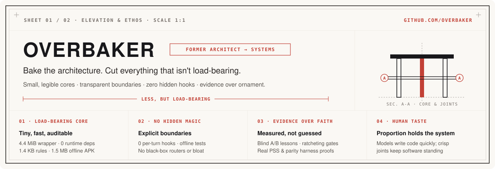
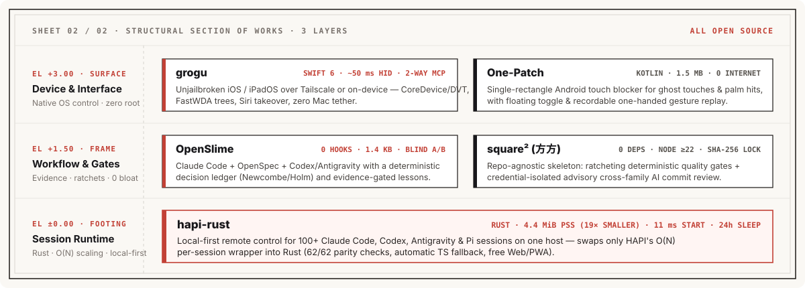

  <picture>
    <source media="(prefers-color-scheme: dark)" srcset="assets/sheet-hero-dark.svg" />
    
  </picture>

  <picture>
    <source media="(prefers-color-scheme: dark)" srcset="assets/sheet-works-dark.svg" />
    
  </picture>

### Drawing Schedule · Open-Source Works

| No. | Project | Layer | Load-Bearing Spec |
|---|---|---|---|
| `01` | **[hapi-rust](https://github.com/Overbaker/hapi-rust)** | Session Runtime | Rust session wrapper for 100+ Claude Code / Codex / Antigravity / Pi sessions — **4.4 MiB** PSS (19× smaller), **11 ms** cold start, 24 h auto-hibernation · [Docs](https://overbaker.github.io/hapi-rust/) |
| `02` | **[OpenSlime](https://github.com/Overbaker/OpenSlime)** | Agent Workflow | Minimal Claude Code + OpenSpec collaboration — **0 hooks**, **1.4 KB** always-on, deterministic decision ledger & blind A/B lessons |
| `03` | **[square² (方方)](https://github.com/Overbaker/square2)** | Repo Governance | **0 runtime deps** (Node ≥ 22) — ratcheting deterministic quality gates + credential-isolated advisory cross-family AI review |
| `04` | **[grogu](https://github.com/Overbaker/grogu)** | iOS / iPadOS | Control unjailbroken iOS natively over Tailscale or on-device (Swift 6) — DVT telemetry, **~50 ms** HID, Siri takeover & 2-way MCP |
| `05` | **[One-Patch](https://github.com/Overbaker/One-Patch)** | Android Utility | **1.5 MB**, **0 internet permissions** — single-rectangle touch blocker with floating toggle & recordable one-handed gesture replay |

---

Former architect, now baking software structures with the same rule as <a href="https://github.com/badlogic/pi-mono">Pi</a>: if a part isn't load-bearing, leave it out. Contributions &amp; co-maintainers welcome across all repos.
